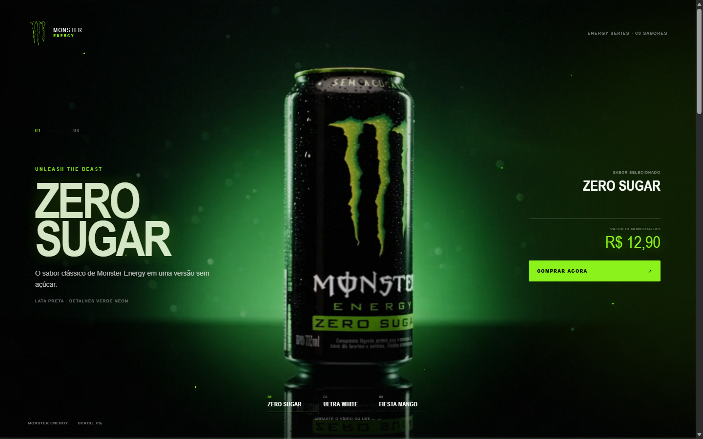

# Monster Energy — Product Experience

Landing page interativa inspirada na identidade visual da Monster Energy, com seleção de sabores, vídeo controlado pela rolagem e um checkout demonstrativo responsivo.

> Projeto de estudo, sem vínculo oficial com a Monster Energy Company. Os preços e o fluxo de compra são apenas demonstrativos.

## Preview

### Experiência principal



### Checkout demonstrativo


## Destaques

- vídeo em tela cheia sincronizado com o scroll;
- três sabores com paletas, textos e preços próprios;
- navegação por abas, gesto de arrastar e teclas `←` e `→`;
- transições, partículas e efeitos visuais responsivos;
- checkout com seleção de produto, quantidade e total dinâmico;
- suporte a `prefers-reduced-motion` e atributos de acessibilidade;
- implementação em HTML, CSS e JavaScript puros, sem dependências.

## Tecnologias

- HTML5
- CSS3
- JavaScript (ES6+)

## Como executar

Não há etapa de instalação ou build. Clone o repositório e abra `index.html` no navegador:

```bash
git clone https://github.com/jo4ogari/monster--see-dance.git
cd monster--see-dance
```

Também é possível servir a pasta com qualquer servidor HTTP estático. Por exemplo:

```bash
npx serve .
```

## Estrutura do projeto

```text
.
├── index.html          # experiência principal
├── styles.css          # estilos da landing page
├── script.js           # vídeo, scroll e troca de sabores
├── flavors.js          # catálogo, preços e paletas
├── checkout.html       # página de checkout
├── checkout.css        # estilos do checkout
├── checkout.js         # quantidade e resumo do pedido
├── Video 1.mp4         # vídeo principal
└── docs/images/        # imagens usadas neste README
```

## Personalização

Os sabores e preços ficam centralizados em `flavors.js`. Edite os objetos em `window.MONSTER_FLAVORS` para alterar textos, valores ou cores sem modificar a estrutura das páginas.

O botão final do checkout não realiza cobranças. Para transformar a demonstração em uma loja real, conecte o fluxo a um backend e a um provedor de pagamentos.
