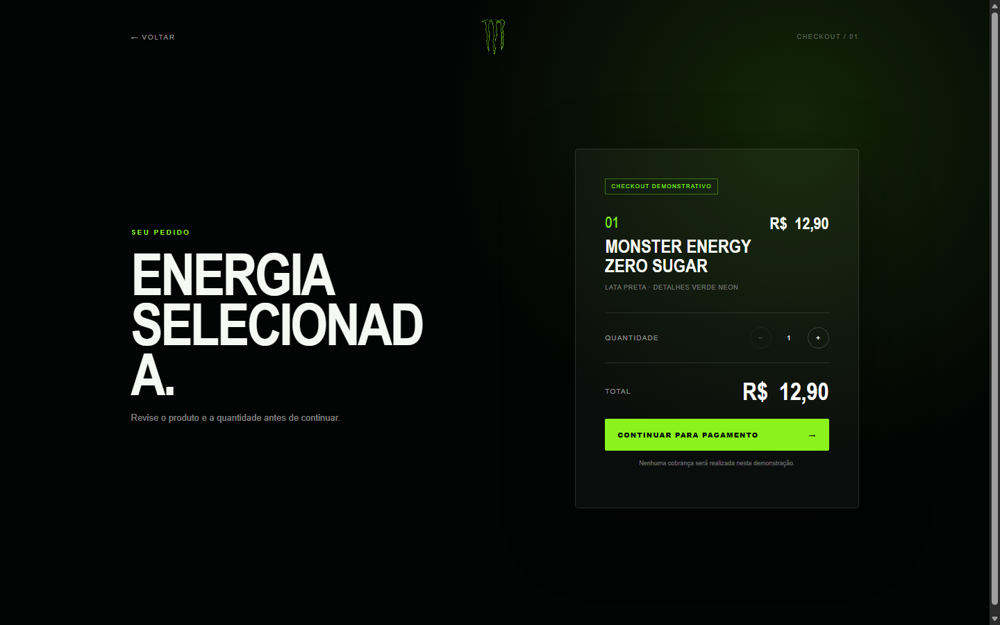

# Monster Energy — Processo de criação

O projeto começou com a construção de uma experiência visual inspirada na identidade da Monster Energy. A página principal foi estruturada para destacar o produto em tela cheia, utilizando um vídeo como plano de fundo e elementos sobrepostos para apresentar nome, descrição, preço e opções de compra.

Em seguida, foram adicionados três sabores com conteúdos e paletas de cores próprias. A troca entre eles foi conectada à reprodução do vídeo e à rolagem da página, permitindo navegar também pelas abas, pelas setas do teclado ou pelo gesto de arrastar.

Depois da experiência principal, foi criado um checkout demonstrativo. Ele recebe o sabor escolhido, exibe o resumo do produto e permite alterar a quantidade, atualizando automaticamente o valor total. O fluxo não realiza cobranças reais.

Por fim, o layout foi adaptado para diferentes tamanhos de tela e recebeu animações, partículas, contraste visual e recursos de acessibilidade. Todo o projeto foi desenvolvido com HTML, CSS e JavaScript, sem frameworks ou dependências externas.

